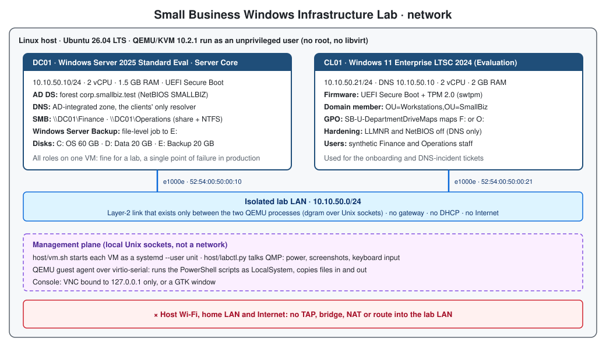
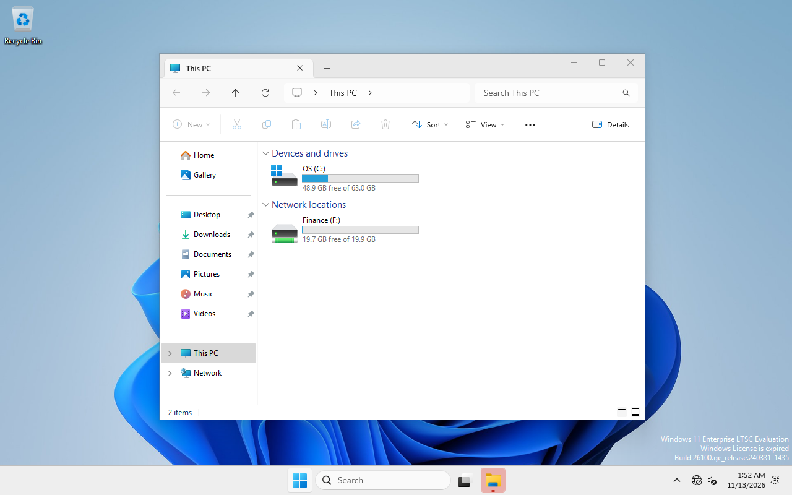
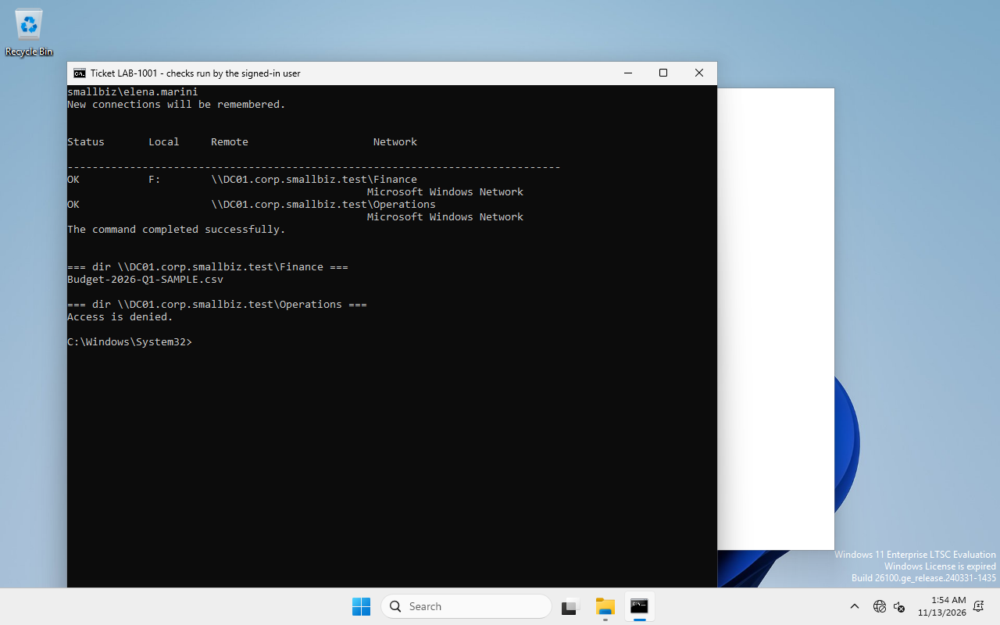
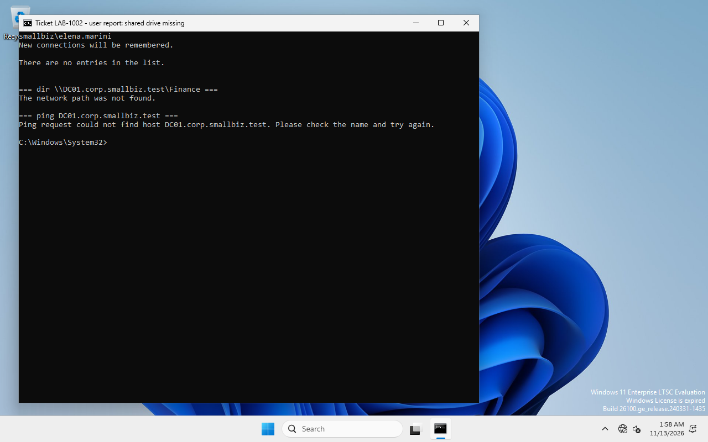
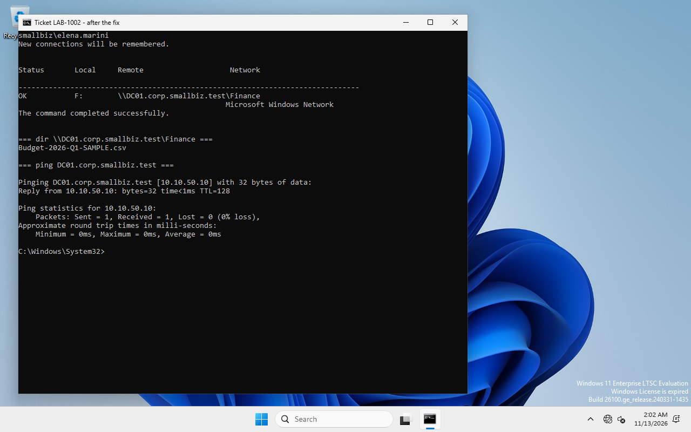

# Small Business Windows Infrastructure Lab

**Personal lab** · a two-VM Windows domain for a small office, built with PowerShell on an isolated
virtual network, with two realistic support tickets and a file-restore drill, all tested and
documented with real output.

🇮🇹 [Panoramica in italiano](README.it.md) · 🇮🇷 [راهنمای فارسی](docs/walkthrough.fa.md)

| | |
|---|---|
| **Server** | DC01 · Windows Server 2025 Standard (Evaluation), Server Core · AD DS, DNS, SMB file shares, Windows Server Backup |
| **Client** | CL01 · Windows 11 Enterprise LTSC 2024 (Evaluation) · domain-joined, Secure Boot + TPM 2.0 |
| **Network** | isolated 10.10.50.0/24 between the two VMs only: no gateway, no Internet |
| **Hypervisor** | QEMU/KVM on Ubuntu, run without root |
| **Result** | 34 checks PASS, 0 open failures, 2 reproducibility items pending ([test results](docs/test-results.md)) |



## What it shows

* **Active Directory from scratch:** new forest `corp.smallbiz.test`, OU design, **AGDLP** groups
  (`GG_Finance` → `DL_FS_Finance_Modify` → permission), synthetic staff, new computers redirected to
  `OU=Workstations`.
* **File services done properly:** one share per department; access enforced by **share + NTFS**
  permissions (inheritance removed, access-based enumeration). Access is verified on the UNC paths,
  not just through drive letters.
* **Group Policy:** one GPO maps `F:` or `O:` with Group Policy Preferences item-level targeting, plus
  *Always wait for the network* so it applies at sign-in.
* **Support work:** onboarding a new hire end to end, and a DNS incident reproduced, diagnosed
  bottom-up from the client, fixed and verified.
* **Backup and recovery:** Windows Server Backup restore to an alternate location, verified by SHA-256.
* **Automation and evidence:** unattended Windows installs, idempotent PowerShell scripts, a host
  tool that runs them through the QEMU guest agent, and every result kept in [`evidence/`](evidence/).

## Results at a glance

| Scenario | What was checked | Result |
|---|---|---|
| **Build** | DC01 roles, forest, OUs/groups/users, shares + ACLs, GPO, CL01 join, `dcdiag`, network isolation | 12 PASS · 1 INFO |
| **Ticket 1 – onboarding** (Finance hire, by hand; Operations hire, scripted) | forced password change at first sign-in · own drive mapped · own share read/write via UNC · other drive not mapped · other share **Access denied** | 7/7 PASS |
| **Ticket 2 – DNS incident** | fault reproduced after reboot → client-side diagnosis → fix → user verified | 7/7 PASS (3 intermediate failures found and fixed, documented) |
| **File recovery** | backup → simulated overwrite → restore elsewhere → hash = original → put back | 5/5 PASS |

Full matrix with expected vs observed for every check: **[docs/test-results.md](docs/test-results.md)**.

## Ticket 1 · New employee onboarding

`10-New-OnboardingUser.ps1` on DC01 creates the account in the department OU, adds it to **one**
role group and forces a password change. The new hire then signs in on CL01, and the checks run
**inside the user's own session**:

```text
User: smallbiz\elena.marini   Computer: CL01
Domain groups in token: SMALLBIZ\GG_Finance, SMALLBIZ\DL_FS_Finance_Modify
AC-F1 F: drive mapped by GPO         F: -> \\DC01.corp.smallbiz.test\Finance              PASS
AC-F2 List own share via UNC         \\DC01.corp.smallbiz.test\Finance : OK               PASS
AC-F3 Write to own share via UNC     OK (created and deleted a test file)                 PASS
AC-O1 O: drive NOT mapped            not mapped                                           PASS
AC-O2 Other department share via UNC \\DC01.corp.smallbiz.test\Operations : ACCESS DENIED PASS
```

 

Runbook: [RB-01](docs/runbooks/RB-01-new-employee-onboarding.md)

## Ticket 2 · "My shared drive is gone" (DNS)

The client's DNS server is changed to 8.8.8.8 (a common real mistake) and the PC restarts. The user
can still sign in with cached credentials, but `F:` is missing and `\\DC01…\Finance` says *The network
path was not found*. The diagnosis works bottom-up and separates network from name resolution:

```text
D-01 Adapter uses the AD DNS server          expected 10.10.50.10   observed 8.8.8.8         FAIL
D-02 DC reachable by IP (ICMP)               reachable              reachable                PASS
D-04 Resolve DC01.corp.smallbiz.test         10.10.50.10            timeout                  FAIL
D-06 Ask AD DNS 10.10.50.10 directly         10.10.50.10            10.10.50.10              PASS
D-07 DC locator (nltest /dsgetdc)            \\DC01...              ERROR_NO_SUCH_DOMAIN     FAIL
Conclusion: ROOT CAUSE: the adapter 'LAB' uses DNS 8.8.8.8 instead of the AD DNS server 10.10.50.10.
```

The fix sets DNS back, flushes the cache and re-establishes the computer's secure channel. That last
step was **not** in the first version of the script. The first test run exposed it (Netlogon had
cached *no logon servers* during the broken boot), and the failed run is kept as evidence.

 

Runbook: [RB-02](docs/runbooks/RB-02-dns-resolution-incident.md)

## File backup and recovery (scope: one file)

```text
original  SHA-256 92B9803F99A8B93D71B52DC2647EB8C599450E100FBFF1DBCFD0DF5BA03D9611
recovered SHA-256 92B9803F99A8B93D71B52DC2647EB8C599450E100FBFF1DBCFD0DF5BA03D9611   -> match, file put back
```

This is a **restore drill for a single file**, backed up once to a second disk of the same VM.
It is not a backup strategy: no schedule, no off-site/immutable copy, no AD system-state backup.
Runbook and scope: [RB-03](docs/runbooks/RB-03-file-recovery.md).

## Design decisions

* **AD DS + DNS + file shares on one server** keeps the lab small, and it is common in very small
  offices. It is also a single point of failure, and it puts user file traffic on a Tier 0 machine.
  The production alternative is two DCs and a separate file server behind a DFS namespace.
  [Full trade-off](docs/architecture.md#trade-off-ad-ds-dns-and-file-shares-on-one-server).
* Server Core, Standard edition, `.test` domain, LLMNR/NetBIOS off on the client, why the lab LAN is
  built the way it is, and **which script runs on which machine as which account**:
  [docs/architecture.md](docs/architecture.md).

## Repository layout

```text
host/                     Linux host side (no root needed)
  vm.sh                   start/stop/install the VMs (QEMU/KVM, OVMF Secure Boot, swtpm)
  labctl.py               QMP + guest-agent tool: run scripts, copy files, screenshots, keystrokes
  run-lab.sh              the full sequence in stages (prepare, install, dc01, cl01, tickets, verify)
  unattend/*.xml.tmpl     answer-file templates (passwords filled in locally, never committed)
  00-get-userspace-qemu.sh, 01-get-media.sh, build-config-iso.sh, wiminfo.py, check-no-secrets.py
scripts/                  PowerShell, copied to C:\LabSetup in the VMs
  config/LabConfig.psd1   single source of truth (names, IPs, departments, synthetic staff)
  server/01..06, 10       DC01: baseline, forest, directory, shares, GPO, backup demo, onboarding
  client/01..03, 10, 20-22  CL01: baseline, join, checks, user access test, DNS fault/diagnose/repair
docs/                     architecture, test results, runbooks RB-01..03, Persian walkthrough
evidence/                 sanitised logs and screenshots from the reference run
```

## Reproduce it

Requirements: a Linux host with KVM (`/dev/kvm` access), ~6 GB free RAM, ~45 GB disk.

```bash
host/00-get-userspace-qemu.sh      # or: sudo apt install qemu-system-x86 qemu-utils ovmf swtpm xorriso
host/01-get-media.sh               # evaluation ISOs from the Microsoft Evaluation Center + virtio-win
host/run-lab.sh prepare            # local secrets + answer-file ISOs
host/run-lab.sh install dc01 && host/run-lab.sh dc01 && host/run-lab.sh backup
host/run-lab.sh install cl01 && host/run-lab.sh cl01
host/run-lab.sh ticket1 Elena Marini Finance LAB-1001
host/run-lab.sh ticket2 elena.marini Finance LAB-1002
host/run-lab.sh verify
host/vm.sh console cl01            # VNC on 127.0.0.1 - or start with LAB_DISPLAY=gtk
```

Each guest script also runs by hand inside the VM (it prompts for passwords). The step-by-step
manual path is in the runbooks and in the [Persian walkthrough](docs/walkthrough.fa.md).
The `ticket1`, `ticket2` and `verify` stages were run end to end. The other stages contain the same
commands that were run one by one on the reference host (see [Reproducibility](docs/test-results.md#reproducibility)).

## Limitations

* **Evaluation licences, offline.** Windows Server 2025 started its 10-day activation grace period
  normally. The **Windows 11 Enterprise LTSC 2024 evaluation went straight into notification mode**
  (`0xC004F009`, "Windows License is expired") on this offline install. Everything worked, but expect
  the watermark and possible periodic shutdowns. For longer use, activate online or use licensed media.
* CL01 runs with 2 GB RAM using `BypassRAMCheck` (lab only). Secure Boot and TPM 2.0 are real.
* One DC, no DHCP, static IPs, and lab passwords generated locally: intentionally small, see the trade-offs.
* During the reference install two console actions were done by hand (Enter at the firmware boot
  menu; restarting CL01 without the install ISO). `vm.sh` was improved afterwards, but that change
  has not been re-run from scratch (marked **PENDING**).

## How this lab was produced

Designed, built and tested on 13 November 2026 on a personal Ubuntu laptop, with the help of an AI
coding assistant (Claude Code). The logs and screenshots in `evidence/` are the unedited output of
that run; only host file paths and trailing spaces were removed. No real people, companies or
credentials are involved.

## License

[MIT](LICENSE)
