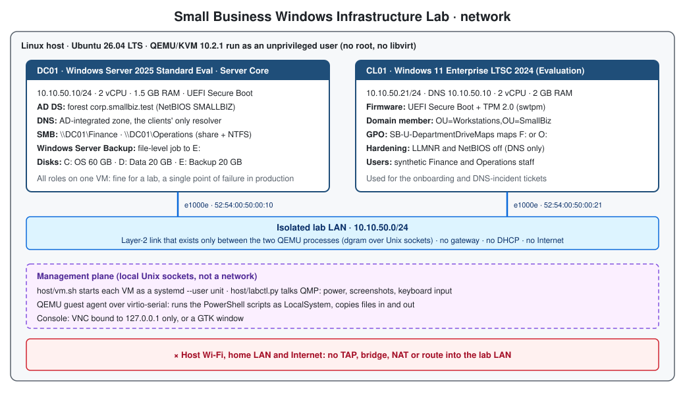

# Architecture and design decisions



## Components

| VM | Operating system (evaluation media) | Roles in this lab | Lab IP | vCPU / RAM | Disks | Firmware |
|---|---|---|---|---|---|---|
| **DC01** | Windows Server 2025 Standard Evaluation, **Server Core** (build 26100.32230) | AD DS (forest `corp.smallbiz.test`, NetBIOS `SMALLBIZ`, domain functional level Windows2025Domain), DNS, SMB file server, Windows Server Backup | 10.10.50.10/24 | 2 / 1.5 GB | C: OS 60 GB, D: Data 20 GB, E: Backup 20 GB (thin qcow2) | UEFI + Secure Boot |
| **CL01** | Windows 11 Enterprise LTSC 2024 Evaluation (build 26100.1742) | Domain-joined workstation used for the tickets | 10.10.50.21/24 | 2 / 2 GB | C: OS 64 GB (thin qcow2) | UEFI + Secure Boot + TPM 2.0 |

The host is an Ubuntu 26.04 laptop (16 threads, 10 GiB RAM) without root access.
QEMU 10.2.1, OVMF and swtpm are Ubuntu packages unpacked into a user folder
(`host/00-get-userspace-qemu.sh`); KVM acceleration works because the desktop session has an
ACL on `/dev/kvm`. With `sudo apt install qemu-system-x86 qemu-utils ovmf swtpm xorriso` the
same scripts use the system packages instead.

## Network isolation

* Each VM has **one** NIC (Intel e1000e, inbox driver). The two NICs are connected by a QEMU
  `dgram` link over Unix domain sockets in `$XDG_RUNTIME_DIR/smallbiz-lab/`: an Ethernet
  segment that exists only between the two QEMU processes.
* No TAP device, bridge, NAT, DHCP or default gateway. The VMs cannot reach the host LAN or the
  Internet, and nothing on the host LAN can reach them.
* Management does **not** use the network: `host/labctl.py` talks to QEMU (QMP) and to the
  QEMU guest agent (virtio-serial) over local Unix sockets. The console is VNC on 127.0.0.1.
* Consequence: static IPs (no DHCP role was requested), and evaluation editions cannot
  activate online. They run inside the activation grace period, which is enough for the demo.
  For longer use, activate them through a temporary, deliberate Internet connection.

## Why these choices

| Decision | Reason |
|---|---|
| Server **Core** for DC01 | Smaller attack surface, fewer updates and ~1 GB less RAM than Desktop Experience. Everything here is PowerShell anyway; the scripts also work on Desktop Experience. |
| **Standard** edition | The edition a small business normally licenses; Datacenter adds nothing this lab needs. |
| Windows 11 **Enterprise LTSC** for CL01 | Domain join needs Pro/Enterprise/Education (not Home). LTSC has no Store apps, so it runs acceptably in 2 GB. |
| Secure Boot + vTPM on CL01 | Keeps the real Windows 11 requirements. **One lab-only deviation:** `BypassRAMCheck` in the answer file, because the host can only spare 2 GB (setup wants 4 GB). |
| `svm=off` on the vCPU | Prevents nested virtualisation, so Windows does not start VBS/Hyper-V inside a 2 GB VM. |
| `.test` domain | Reserved by RFC 2606/6761, so it can never clash with a real public domain. A production domain should be a subdomain of a domain the company owns (e.g. `ad.company.it`). |
| Unattended install + guest agent | The whole build is repeatable from the scripts; secrets are generated locally and passed to guest scripts on standard input, never on a command line and never in the repository. |

## Trade-off: AD DS, DNS and file shares on one server

Putting all three roles on DC01 is **acceptable for a lab** and is common in very small
offices, but it is not what I would recommend for production.

**Why it is attractive:** one Windows Server licence/VM to buy, patch, monitor and back up;
simple to explain; fits a 5–20 person office.

**What it costs:**

* **Single point of failure.** If DC01 is down, users cannot authenticate (only cached logons
  work), names do not resolve and the shares are gone, all at once.
* **Security tiering.** A domain controller is a Tier 0 asset: whoever administers it controls
  the whole domain. Hosting file shares on it means every user connects to the DC over SMB,
  file-server work requires DC-level admin rights (DCs have no local Administrators group), and
  ransomware that reaches the shares reaches the DC's disks.
* **Maintenance.** Every patch reboot takes authentication, DNS and files down together.
* **Recovery.** Restoring a DC (system state, USN rollback risks) is a different and more
  delicate job than restoring a file server; mixing them complicates the backup plan.

**Production version:** two domain controllers (AD DS + DNS) on different hosts, a separate
member file server (or NAS / SharePoint), share paths published through a DFS namespace
(`\\corp.example\files\Finance`) so the server can change without touching drive mappings, and
backups that follow 3-2-1 with an offline or immutable copy.

## Active Directory design

```
corp.smallbiz.test
└─ OU=SmallBiz
   ├─ OU=Users
   │  ├─ OU=Finance        giulia.bianchi, luca.ferri  (+ elena.marini, ticket 1)
   │  └─ OU=Operations     marco.verdi, sara.conti
   ├─ OU=Groups            GG_Finance, GG_Operations (Global)
   │                       DL_FS_Finance_Modify, DL_FS_Operations_Modify (Domain Local)
   └─ OU=Workstations      CL01  (redircmp: default container for new computers)
```

All accounts are **synthetic** (fictional names, lab-only passwords).

**AGDLP** (Accounts → Global groups → Domain Local groups → Permissions): the global group says
*who you are* (department), the domain-local group says *what you may use* (Modify on one
share). Moving a person between departments is one group change; adding a second share for
Finance is one ACL change. See [access-model.svg](images/access-model.svg).

## Permissions

| Share | Path | Share permissions | NTFS permissions | Other settings |
|---|---|---|---|---|
| `\\DC01.corp.smallbiz.test\Finance` | D:\Shares\Finance | Administrators: Full · DL_FS_Finance_Modify: Change | inheritance removed · SYSTEM, Administrators: Full · DL_FS_Finance_Modify: Modify | Access-based enumeration on, offline caching off |
| `\\DC01.corp.smallbiz.test\Operations` | D:\Shares\Operations | Administrators: Full · DL_FS_Operations_Modify: Change | same pattern with DL_FS_Operations_Modify | same |

Effective access is the more restrictive of share and NTFS permissions. Both layers grant only
the department's domain-local group, so removing someone from `GG_Finance` removes access in one
step (after their next sign-in, when the token is rebuilt).

## Group Policy

One GPO, **`SB-U-DepartmentDriveMaps`**, linked to `OU=SmallBiz`:

* *User Configuration › Preferences › Windows Settings › Drive Maps*:
  `F:` → `\\DC01.corp.smallbiz.test\Finance`, `O:` → `\\DC01.corp.smallbiz.test\Operations`,
  action *Replace*, each with **item-level targeting** on the department's global group.
* *Computer Configuration › Administrative Templates › System › Logon › Always wait for the
  network at computer startup and logon* = Enabled, so the drive maps apply at sign-in instead of
  on the next background refresh.

The drive letter is a **convenience**: it does not grant anything. Access is tested separately
on the UNC paths.

## Where each script runs

| Step | Script | Runs on | As | Notes |
|---|---|---|---|---|
| Host prep | `host/00-get-userspace-qemu.sh`, `host/01-get-media.sh` | Linux host | your user | no root needed |
| Build answer media | `host/build-config-iso.sh dc01\|cl01` | Linux host | your user | renders passwords from the local secrets file |
| Install VMs | `host/vm.sh install dc01\|cl01` | Linux host | your user | unattended Windows setup |
| Server baseline | `scripts/server/01-Initialize-DC01.ps1` | **DC01** | local Administrator, elevated | IP, disks, roles |
| New forest | `scripts/server/02-Install-ADForest.ps1` | **DC01** | local Administrator, elevated | prompts for DSRM password, reboots |
| OUs, groups, users | `scripts/server/03-New-LabDirectory.ps1` | **DC01** | SMALLBIZ\Administrator | prompts for the staff temporary password |
| Shares + ACLs | `scripts/server/04-New-DepartmentShares.ps1` | **DC01** | SMALLBIZ\Administrator | |
| Drive-map GPO | `scripts/server/05-New-DriveMapGpo.ps1` | **DC01** | SMALLBIZ\Administrator | |
| Backup/restore demo | `scripts/server/06-Invoke-FileRecoveryDemo.ps1` | **DC01** | SMALLBIZ\Administrator | |
| Client baseline | `scripts/client/01-Initialize-CL01.ps1` | **CL01** | local admin `labadmin`, elevated | IP, DNS, hardening |
| Domain join | `scripts/client/02-Join-LabDomain.ps1` | **CL01** | local admin, elevated | prompts for SMALLBIZ\Administrator, reboots |
| Join check | `scripts/client/03-Test-DomainMembership.ps1` | **CL01** | admin, elevated | |
| Ticket 1 – account | `scripts/server/10-New-OnboardingUser.ps1` | **DC01** | SMALLBIZ\Administrator | |
| Ticket 1 – user test | `scripts/client/10-Test-DepartmentAccess.ps1` | **CL01** | **the new user**, not elevated | run in the user's own session |
| Ticket 2 – fault | `scripts/client/20-Set-DnsFault.ps1` | **CL01** | local admin, elevated | lab only, refuses to run elsewhere |
| Ticket 2 – diagnose | `scripts/client/21-Get-DnsDiagnostics.ps1` | **CL01** | any user | read-only |
| Ticket 2 – fix | `scripts/client/22-Repair-ClientDns.ps1` | **CL01** | local admin, elevated | |

In the automated run, `host/labctl.py` executes the guest scripts through the QEMU guest agent
(LocalSystem). On a domain controller LocalSystem has full rights on the directory, so it is
equivalent to running them as a Domain Admin. User-context checks are started inside the
signed-in user's own session with `scripts/client/tools/Invoke-InUserSession.ps1`.

## Installation media

| File | Source | SHA-256 recorded on the reference host (13 Nov 2026) |
|---|---|---|
| `WS2025_SERVER_EVAL_x64FRE_en-us.iso` (8.15 GB, build 26100.32230) | Microsoft Evaluation Center, Windows Server 2025, ISO en-US | `7b052573ba7894c9924e3e87ba732ccd354d18cb75a883efa9b900ea125bfd51` |
| `Win11_Ent_LTSC2024_EVAL_x64FRE_en-us.iso` (5.11 GB, build 26100.1742) | Microsoft Evaluation Center, Windows 11 Enterprise LTSC, ISO en-US | `67cec5865eaa037a72ddc633a717a10a2bed50778862267223ddb9c60ef5da68` |
| `virtio-win.iso` (0.1.302) | fedorapeople.org stable virtio-win | `303f7ae40dad495d6ae474fdc571df58958a4dbc5c37a522d80f9a203867949d` |

Microsoft does not publish checksums on the evaluation download pages, so these hashes only
let you confirm you have the same files as the reference run. The edition indexes inside
`install.wim` were read with `host/wiminfo.py`.

## Known limitations

* Single DC, single file server, no DHCP, no Internet: by design for the lab, see the trade-off above.
* Evaluation licences (non-production use only). Offline, DC01 reported its normal 10-day activation
  grace period; **CL01 (Windows 11 Enterprise LTSC 2024 evaluation) went straight to notification mode**
  (`0xC004F009`, watermark "Windows License is expired"). The lab worked, but expect the watermark and
  possible periodic shutdowns; activate online or use licensed media for longer use.
* CL01 uses `BypassRAMCheck` (2 GB RAM). Everything else meets Windows 11 requirements.
* Lab passwords exist in the local secrets file and, during setup, in the generated answer
  file on the LABCFG ISO (both under `lab-runtime/`, mode 600, outside the repository).
