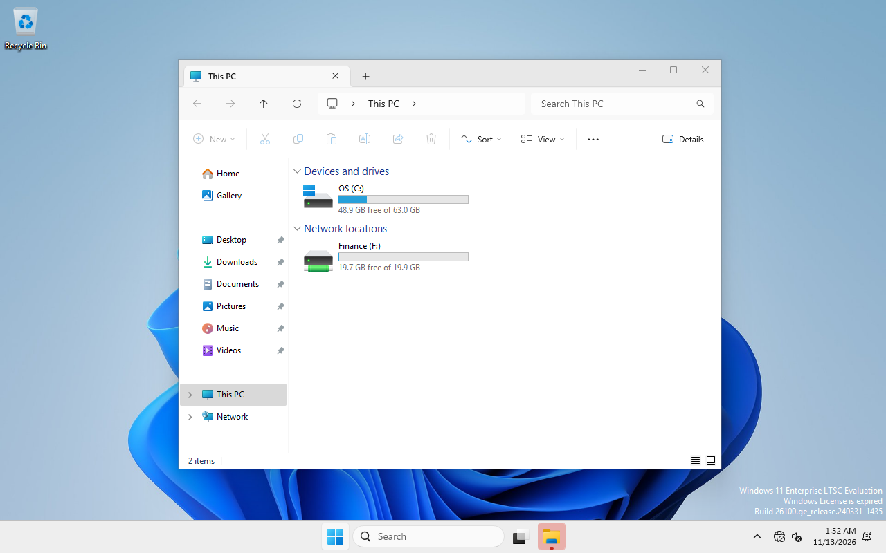
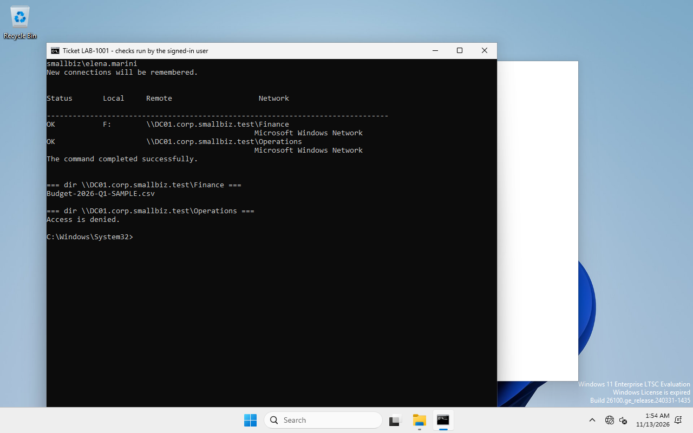

# RB-01 · New employee onboarding

| | |
|---|---|
| **Ticket type** | Service request: "New hire starts Monday in Finance, needs a PC login and the Finance folder" |
| **Systems** | DC01 (account, groups) · CL01 (verification as the user) |
| **Who** | Helpdesk / IT technician with rights to create users in `OU=SmallBiz` |
| **Time** | ~10 minutes |
| **Reference run** | LAB-1001 (Elena Marini, Finance) and LAB-1003 (Paolo Russo, Operations), 13 Nov 2026, both **PASS** |

## 1. Check the request

* Name, department, start date and line manager are in the ticket and approved.
* The department decides the access: **Finance → `GG_Finance`**, **Operations → `GG_Operations`**.
  Never copy groups from "a colleague who has the same job": it copies their mistakes too.
* Search for an existing account first (re-hire, duplicate ticket):
  ```powershell
  Get-ADUser -Filter "Surname -eq 'Marini'" -Properties Department | Select Name, SamAccountName, Department, Enabled
  ```

## 2. Create the account (DC01)

Run on **DC01**, elevated, as `SMALLBIZ\Administrator` or a delegated helpdesk account:

```powershell
C:\LabSetup\server\10-New-OnboardingUser.ps1 -GivenName Elena -Surname Marini -Department Finance `
    -Title 'Accounts Payable Clerk' -TicketId LAB-1001
# prompts for the temporary password (masked)
```

What the script does (equivalent GUI: *Active Directory Users and Computers*):

1. Creates `elena.marini` (UPN `elena.marini@corp.smallbiz.test`) in `OU=Finance,OU=Users,OU=SmallBiz`.
2. Sets the temporary password and **User must change password at next logon**.
3. Adds the user to **`GG_Finance` only**. `GG_Finance` is already a member of `DL_FS_Finance_Modify`,
   which holds the share and NTFS permissions (AGDLP), so no ACL is touched for a new hire.
4. Prints the access chain and confirms the user is **not** in the other department group.

Give the temporary password to the user through a separate channel (in person / phone),
never in the same e-mail as the user name.

Expected output (reference run):

```text
SamAccountName     : elena.marini
OU                 : OU=Finance,OU=Users,OU=SmallBiz,DC=corp,DC=smallbiz,DC=test
Enabled            : True
MustChangePassword : True
DirectGroups       : GG_Finance
Access chain: elena.marini -> GG_Finance -> DL_FS_Finance_Modify -> \\DC01.corp.smallbiz.test\Finance  (OK)
Not a member of GG_Operations: confirmed
```

## 3. First sign-in (CL01, as the user)

1. On CL01 press **Ctrl+Alt+Del** → user name `SMALLBIZ\elena.marini` → temporary password.
2. Windows shows *"The user's password must be changed before signing in"* → **OK** → new password twice.
3. *"Your password has been changed"* → **OK**. The first sign-in builds the profile (about a minute).

## 4. Verify (CL01, as the user, NOT elevated)

The drive letter proves the GPO ran; it does not prove permissions. Test both, on the direct UNC paths:

```powershell
powershell -ExecutionPolicy Bypass -File C:\LabSetup\client\10-Test-DepartmentAccess.ps1
```

| Check | Expected (Finance user) | Reference result |
|---|---|---|
| Groups in the token | `GG_Finance`, `DL_FS_Finance_Modify` | ✔ |
| `F:` mapped by GPO | `F: → \\DC01.corp.smallbiz.test\Finance` | **PASS** |
| List `\\DC01.corp.smallbiz.test\Finance` | OK | **PASS** |
| Create + delete a test file in Finance | OK | **PASS** |
| `O:` mapped | not mapped | **PASS** |
| List `\\DC01.corp.smallbiz.test\Operations` | **Access denied** | **PASS** |

Quick manual version (any `cmd` window as the user):

```cmd
whoami
net use
dir \\DC01.corp.smallbiz.test\Finance
dir \\DC01.corp.smallbiz.test\Operations      -> "Access is denied."
```




## 5. Close the ticket

Record: account name, OU, groups added, verification result (the table above), and that the
temporary password was handed over separately. Evidence:
[`evidence/logs/ticket1-onboarding/`](../../evidence/logs/ticket1-onboarding/).

## Troubleshooting

| Symptom | Likely cause | Check / fix |
|---|---|---|
| No `F:` drive, but UNC works | GPO not applied yet, or user signed in before the group change | `gpresult /r /scope user` (look for *SB-U-DepartmentDriveMaps*); sign out and in; `gpupdate /target:user /force` |
| UNC says *Access denied* for the own department | User not in `GG_<Dept>`, or token is old | `whoami /groups`; group changes need a new sign-in (new Kerberos token) |
| *The network path was not found* | Name resolution, not permissions | Follow [RB-02](RB-02-dns-resolution-incident.md) |
| Sign-in: *The trust relationship… failed* | Computer secure channel | `Test-ComputerSecureChannel` as admin; RB-02 step 5 |

## Offboarding (reverse, for reference)

Disable the account (do not delete it yet), remove it from `GG_*` groups, reset the password,
move it to a "Disabled users" OU, and keep it for the retention period agreed with HR.
