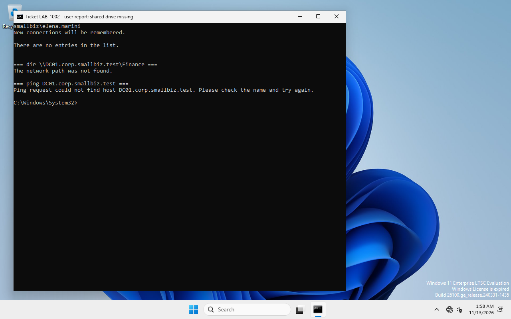
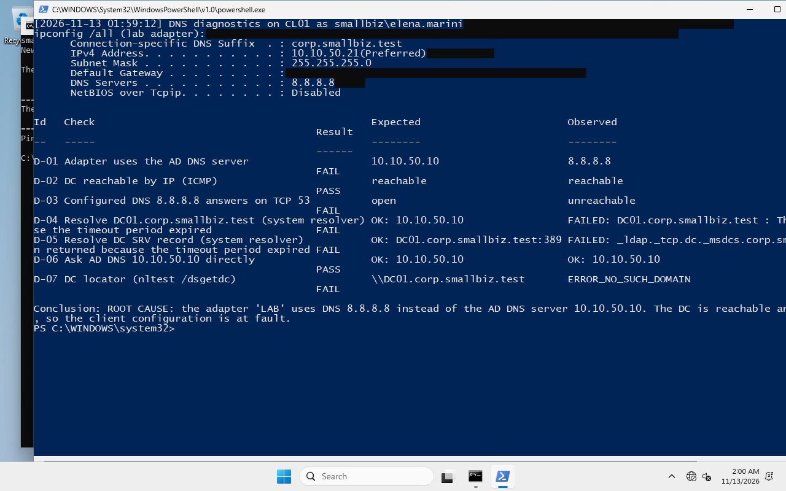
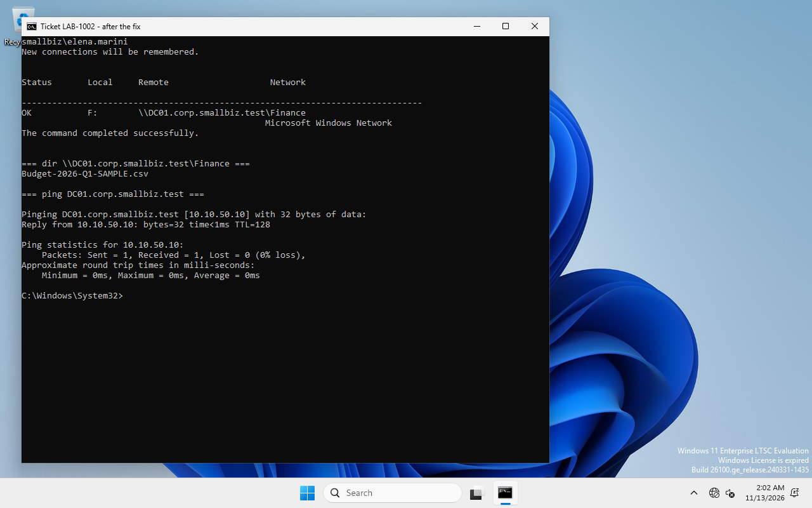

# RB-02 · DNS incident: "the shared drive is gone"

| | |
|---|---|
| **Ticket type** | Incident: "This morning F: is missing and \\DC01\Finance says the network path was not found" |
| **Systems** | CL01 (affected client) · DC01 (DNS server, only checked) |
| **Who** | IT technician with local admin rights on the PC |
| **Reference run** | LAB-1002 (manual, Elena Marini) and LAB-1004 (scripted, Paolo Russo), 13 Nov 2026, both **PASS** |

## 0. Lab only: create the fault

```powershell
# CL01, elevated. Refuses to run on any machine other than CL01 in corp.smallbiz.test.
C:\LabSetup\client\20-Set-DnsFault.ps1          # DNS of the LAB adapter -> 8.8.8.8
Restart-Computer                                # "the user arrives the next morning"
```

This is a frequent real mistake: someone "fixes the Internet" on a domain PC by typing a public
resolver. Public DNS servers do not know the internal zone `corp.smallbiz.test`, so every
domain name fails. In this isolated lab 8.8.8.8 is also unreachable; with Internet it would
answer, but with *non-existent domain*. The result for the user is the same.

## 1. Reproduce what the user sees

Sign in as the user (cached credentials still work without a DC) and run, **as the user**:

```cmd
net use                                    -> "There are no entries in the list."
dir \\DC01.corp.smallbiz.test\Finance      -> "The network path was not found."
ping DC01.corp.smallbiz.test               -> "could not find host"
```



*The network path was not found* is a **name/network** error, not a permissions error
(that would be *Access is denied*). So: don't touch ACLs or groups.

## 2. Diagnose from the client, bottom-up

```powershell
C:\LabSetup\client\21-Get-DnsDiagnostics.ps1      # read-only, any user
```

Manual equivalents and what each one tells you:

| # | Command | Healthy | During the incident | Meaning |
|---|---|---|---|---|
| D-01 | `ipconfig /all` / `Get-DnsClientServerAddress -InterfaceAlias LAB` | 10.10.50.10 | **8.8.8.8** | client uses the wrong resolver |
| D-02 | `ping 10.10.50.10` | reply | **reply** | network and IP are fine |
| D-03 | `Test-NetConnection 8.8.8.8 -Port 53` | – | unreachable | the configured DNS cannot even be reached |
| D-04 | `Resolve-DnsName DC01.corp.smallbiz.test` | 10.10.50.10 | **timeout** | names fail through the configured resolver |
| D-05 | `Resolve-DnsName _ldap._tcp.dc._msdcs.corp.smallbiz.test -Type SRV` | dc01…:389 | **timeout** | DC locator records unavailable |
| D-06 | `Resolve-DnsName DC01.corp.smallbiz.test -Server 10.10.50.10` | 10.10.50.10 | **10.10.50.10** | the AD DNS server itself is healthy |
| D-07 | `nltest /dsgetdc:corp.smallbiz.test /force` | \\DC01… | **ERROR_NO_SUCH_DOMAIN** | the PC cannot find a domain controller |

D-02 + D-06 succeeding while D-01/D-04 fail isolates the fault to **the client's DNS setting**.
The script's conclusion on the reference run:

> ROOT CAUSE: the adapter 'LAB' uses DNS 8.8.8.8 instead of the AD DNS server 10.10.50.10.
> The DC is reachable and its DNS answers correctly, so the client configuration is at fault.



## 3. Fix

```powershell
C:\LabSetup\client\22-Repair-ClientDns.ps1      # CL01, elevated
```

which does:

```powershell
Set-DnsClientServerAddress -InterfaceAlias LAB -ServerAddresses 10.10.50.10
Clear-DnsClientCache
Register-DnsClient                               # = ipconfig /registerdns
# PC booted without a DC -> Netlogon cached "no logon servers": rediscover and rebuild the channel
nltest /dsgetdc:corp.smallbiz.test /force
nltest /sc_reset:corp.smallbiz.test               # retried for up to ~90 s
```

In production the DNS server normally comes from DHCP: remove the wrong static entry
(`Set-DnsClientServerAddress -ResetServerAddresses`) or correct DHCP option 006 instead.

**Lesson from the reference run.** The first repair run fixed DNS but reported
`R-04 Secure channel: False` (`nltest /sc_query` → `ERROR_NO_LOGON_SERVERS`). The PC had booted
while no DC could be found, and Netlogon kept that state. The `/sc_reset` step was added; a
second issue appeared in the scripted run (the reset ran in the same second as the DNS change and
hit Netlogon's negative cache), so the script now forces rediscovery and retries. Both failed
attempts are kept in the evidence folder.

## 4. Verify

As admin (from the repair script):

| Check | Expected | Reference |
|---|---|---|
| R-01 `Resolve-DnsName DC01.corp.smallbiz.test` | 10.10.50.10 | **PASS** |
| R-02 DC SRV record | dc01.corp.smallbiz.test | **PASS** |
| R-03 `nltest /dsgetdc` | \\DC01.corp.smallbiz.test | **PASS** |
| R-04 `Test-ComputerSecureChannel` | True | **PASS** (after `/sc_reset`) |

As the user: sign out and back in, **or** run `gpupdate /target:user /force`, then
`10-Test-DepartmentAccess.ps1`. The share must open on the UNC path, the drive letter must be
back, and the other department must still be denied.

Observed: in the scripted run the first `gpupdate` a few seconds after the repair did not map the
drive yet; a second one ~45 s later did. If the drive is still missing, wait a minute and repeat,
or ask the user to sign out and in.



## 5. Close the ticket

* Root cause: static DNS server 8.8.8.8 on CL01's adapter (human change).
* Fix: DNS reset to the AD DNS server, cache flushed, secure channel re-established.
* Prevention: DNS via DHCP only; remove local admin rights from users; optionally a GPO for
  *DNS Servers* (`Computer Configuration › Administrative Templates › Network › DNS Client`).

Evidence: [`evidence/logs/ticket2-dns-incident/`](../../evidence/logs/ticket2-dns-incident/).
